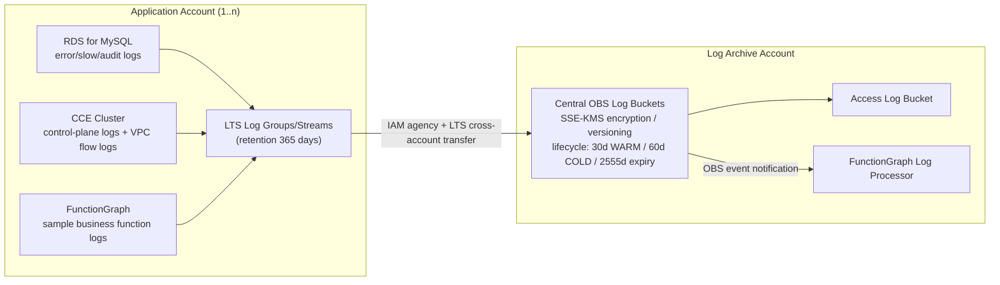

# deterministic-operations-centralized-logging


## 1. Overview

This practice provides an **enterprise-grade centralized logging solution across accounts**: logs from cloud services in multiple application accounts (relational databases, Kubernetes containers, and function computing) are automatically aggregated into a dedicated log archive account, with unified encrypted storage, long-term retention, and further processing.

It is designed for teams that need centralized auditing, long-term retention, and unified log governance (security & compliance, platform operations, SRE). It addresses the pain points of logs scattered across accounts, uncontrollable retention, and the inability to process logs uniformly.

## 2. Table of Contents

- [Architecture](#3-architecture)
- [Highlights](#4-highlights)
- [Cloud Services Involved](#5-cloud-services-involved)
- [Prerequisites](#6-prerequisites)
- [Quick Start](#7-quick-start)
- [Step-by-Step Deployment](#8-step-by-step-deployment)
- [Usage / Verification](#9-usage--verification)
- [Cleanup](#10-cleanup)
- [Detailed Description](#11-detailed-description)
- [Dependencies](#12-dependencies)
- [FAQ / Troubleshooting](#13-faq--troubleshooting)
- [Contributing](#14-contributing)
- [License](#15-license)
- [Contact / Maintainers](#16-contact--maintainers)

## 3. Architecture



Each log source in an application account writes to an LTS log group; LTS transfers logs through a cross-account agency to the central OBS buckets in the log archive account; objects are encrypted, versioned, and tiered via lifecycle rules; new objects trigger a FunctionGraph processor as an extension point. See [Architecture Document](docs/architecture.md) for details.

## 4. Highlights

- **Automated cross-account aggregation**: logs from application accounts flow into the archive account without manual intervention.
- **Encryption end to end**: logs are encrypted in LTS and OBS, with the central buckets encrypted by KMS keys.
- **Long-term retention and lifecycle management**: unified WARM/COLD/expiry policy prevents unbounded growth.
- **Extensible processing**: object creation events drive FunctionGraph for parsing, alerting, or data lake ingestion.
- **Account whitelist with dual constraints**: the archive bucket policy limits write access to listed accounts with least-privilege cross-account setup.

## 5. Cloud Services Involved

- Log Tank Service (LTS)
- Object Storage Service (OBS)
- FunctionGraph
- Cloud Container Engine (CCE)
- Relational Database Service (RDS)
- Virtual Private Cloud (VPC)
- Identity and Access Management (IAM)
- Data Encryption Workshop (DEW/KMS)

> Clean up resources as described in [Chapter 10](#10-cleanup) to avoid leftover resources.

## 6. Prerequisites

- Terraform CLI >= 1.5
- Two Huawei Cloud accounts (at least one application account + one log archive account), both with real-name verification completed.
- Access Keys (AK/SK) for both accounts, preferably supplied via environment variables `HW_ACCESS_KEY` / `HW_SECRET_KEY`.
- The domain name of the log archive account (used for the cross-account agency).
- Default region `cn-north-4`, adjustable as needed.

## 7. Quick Start

```bash
# 1) Deploy the log archive account first
cd infra/log_archive_account
cp terraform.tfvars.example terraform.tfvars   # fill environment / destination_name / agency_domain_name
terraform init && terraform apply

# 2) Deploy the application account next
cd ../application_account
cp terraform.tfvars.example terraform.tfvars   # fill account info and archive bucket names
terraform init && terraform apply
```

The deployment order must not be reversed: the cross-account transfer in the application account references the central buckets of the archive account.

## 8. Step-by-Step Deployment

Detailed commands with expected outputs are in the [Deployment Guide](docs/deployment-guide.md). Core steps:

1. Run `terraform apply` in the log archive account and note the central bucket names for the three services.
2. Fill in `terraform.tfvars` in the application account with the archive bucket names, the account ID/domain/project ID, and the archive account domain name.
3. Run `terraform apply` in the application account to create the log sources, LTS log groups, and the cross-account transfer.

## 9. Usage / Verification

After deployment, verify the centralized log pipeline as follows:

**1) Generate application logs (any log source)**

Invoke the sample business function:

```bash
# In the FunctionGraph console or via CLI, invoke the <environment>-sample-app function
# Or run any SQL against RDS to produce slow/error logs
```

**2) Query logs in the application account LTS**

Sign in to the application account LTS console, open `central-logs-rds` / `central-logs-cce` / `central-logs-function` log groups, and confirm new log entries appear.

**3) Confirm log objects in the archive account central buckets**

Sign in to the log archive account OBS console, open the central bucket for the corresponding service, and confirm log objects appear under the `rds/`, `cce/`, or `function/` prefix with time-based directories (the LTS transfer defaults to a 1-hour period, please wait for one full period).

**4) Verify the log processor is triggered**

In the log archive account FunctionGraph console, check the `prod-log-processor` function logs for `New log object registered` entries, confirming object-creation events drive the processor.

**5) Verify lifecycle and encryption**

In the OBS console, confirm the central buckets have versioning enabled, SSE-KMS encryption, and lifecycle rules (30 days WARM, 60 days COLD, 2555 days expiry).

> Please verify the steps above after deployment to confirm the business functions are usable before considering delivery complete.

## 10. Cleanup

Run `terraform destroy` in reverse order: application account first, then archive account (make sure objects in the central buckets have been preserved as needed before destroying the archive account):

```bash
cd infra/application_account
terraform destroy

cd ../log_archive_account
terraform destroy
```

## 11. Detailed Description

- **Data flow**: log sources → application account LTS → cross-account transfer → archive account central OBS → event-driven processing.
- **Cross-account security**: the application account creates an IAM agency granted only OBS write access; the archive bucket policy further limits write access to the whitelist.
- **Lifecycle**: 30 days to WARM (infrequent access), 60 days to COLD (archive), 2555 days to expiry, with automatic incomplete-multipart cleanup.
- **Function integration**: the FunctionGraph sample function is a minimal runnable example and can be replaced by any business function; once LTS logging is enabled, function logs enter the unified archive pipeline.
- **Extensible processing**: the `log_processor` function registers incoming log objects; parsing, alerting, or data lake ingestion can be added on top.

## 12. Dependencies

| Dependency | Version |
|---|---|
| terraform | >= 1.5 |
| huaweicloud provider | ~> 1.70 |
| random provider | ~> 3.6 |

## 13. FAQ / Troubleshooting

**Q1: No log objects appear in the archive buckets for a long time?**

Confirm the application account LTS log groups have data; confirm the cross-account agency and the bucket policy whitelist include the application account; LTS transfer defaults to a 1-hour period, so wait for one full transfer period.

**Q2: Function logs are not in the central buckets?**

Confirm the FunctionGraph LTS logging capability is enabled (`huaweicloud_fgs_lts_log_enable`). To associate function logs with this solution's aggregated group, configure the function log group to `central-logs-function` in the FunctionGraph console.

**Q3: How to add another application account?**

Copy the `infra/application_account` directory, use a new `account_name` and `terraform.tfvars`, append the new account ID to `source_account_ids` in the archive account, and re-apply.

**Q4: How to adjust the transfer period?**

Modify the `obs_transfer_period` / `obs_transfer_period_unit` variables in both workspaces (supported values: 2/5/30 minutes and 1/3/6/12 hours).

## 14. Contributing

Issues and Pull Requests are welcome. Please follow the repository collaboration conventions and keep the functions consistent with the IaC.

## 15. License

This practice is licensed under the **MIT No Attribution** license. See [LICENSE](LICENSE) in the repository root.

## 16. Contact / Maintainers

| Role | Info |
|---|---|
| **Creator** | [@dgc-git](https://github.com/dgc-git) |
| **Maintainer** | [@dgc-git](https://github.com/dgc-git) |
| Channels | feedback and suggestions via GitHub Issues |
