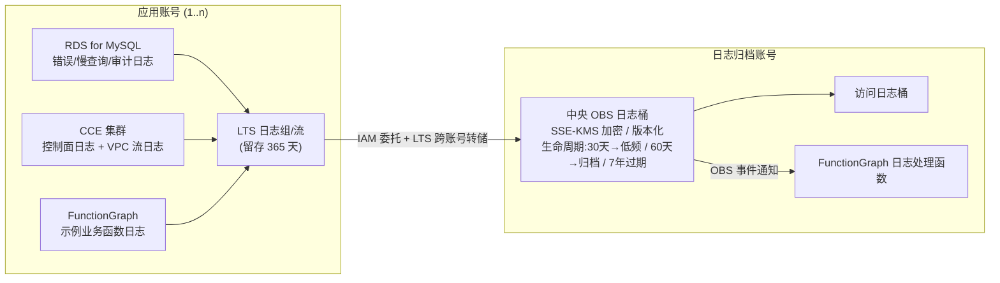

# deterministic-operations-centralized-logging


## 1. 简介

本实践提供一套**跨账号企业级集中式日志管治**方案:多个应用账号内的云服务日志(关系型数据库、Kubernetes 容器、函数计算)自动汇聚到独立的日志归档账号,统一加密存储、长期留存并触发后续处理。

适用于需要集中审计、长期留存与统一治理平台日志的团队(安全合规、平台运维、SRE),解决「日志散落各账号、留存不可控、无法统一加工」的问题。

## 2. 目录

- [架构图](#3-架构图)
- [方案亮点](#4-方案亮点)
- [涉及云服务](#5-涉及云服务)
- [前置条件](#6-前置条件)
- [快速开始](#7-快速开始)
- [分步部署](#8-分步部署)
- [使用方法 / 验证](#9-使用方法--验证)
- [清理资源](#10-清理资源)
- [详细说明](#11-详细说明)
- [依赖](#12-依赖)
- [FAQ / 故障排除](#13-faq--故障排除)
- [贡献指南](#14-贡献指南)
- [许可证](#15-许可证)
- [联系方式 / 维护者](#16-联系方式--维护者)

## 3. 架构图



架构说明:应用账号各日志源写入 LTS 日志组;LTS 通过跨账号委托周期转储到归档账号的中央 OBS 桶;桶内对象加密、版本化并按生命周期分层留存;新对象落盘触发日志处理函数,作为进一步处理的扩展点。详细说明见 [架构文档](docs/architecture.md)。

## 4. 方案亮点

- **跨账号自动汇聚**:应用账号日志无需人工搬运,经委托自动进入归档账号,形成企业级日志单一体。
- **加密贯穿全链路**:日志在 LTS 与 OBS 均启用加密,中央桶按 KMS 密钥加密。
- **长期留存与生命周期管理**:统一执行「低频 → 归档 → 7 年过期」策略,自动避免无限膨胀。
- **可扩展处理**:日志落盘事件驱动 FunctionGraph,可扩展解析、告警、入湖等处理能力。
- **账号白名单双重约束**:归档桶策略限定写入账号,跨账号最小权限。

## 5. 涉及云服务

- 日志服务(LTS)
- 对象存储服务(OBS)
- 函数工作流(FunctionGraph)
- 云容器引擎(CCE)
- 关系型数据库服务(RDS)
- 虚拟私有云(VPC)
- 统一身份认证服务(IAM)
- 数据加密服务(DEW/KMS)
- 云监控相关(流日志接入 LTS)

> 清理资源按 [第 10 章](#10-清理资源) 执行,避免资源残留。

## 6. 前置条件

- Terraform CLI >= 1.5
- 两个华为云账号(至少 1 个应用账号 + 1 个日志归档账号),均已实名认证
- 两账号的 Access Key(AK/SK),建议通过环境变量 `HW_ACCESS_KEY` / `HW_SECRET_KEY` 提供
- 归档账号的账号域名(用于配置跨账号委托)
- 区域默认 `cn-north-4`,可按需调整

## 7. 快速开始

```bash
# 1) 部署日志归档账号(先)
cd infra/log_archive_account
cp terraform.tfvars.example terraform.tfvars   # 填写 environment / destination_name / agency_domain_name 等
terraform init && terraform apply

# 2) 部署应用账号(后)
cd ../application_account
cp terraform.tfvars.example terraform.tfvars   # 填写账号信息与归档桶名
terraform init && terraform apply
```

部署顺序不可颠倒:应用账号的跨账号转储引用归档账号中央桶。

## 8. 分步部署

详细分步命令与预期输出见 [部署指导书](docs/deployment-guide.md)。核心步骤:

1. 在日志归档账号执行 `terraform apply`,得到三个服务的中央桶名。
2. 在应用账号 `terraform.tfvars` 填入归档桶名、本账号 ID/域名/项目 ID、归档账号域名。
3. 应用账号 `terraform apply` 创建日志源、LTS 日志组与跨账号转储。

## 9. 使用方法 / 验证

部署完成后,按以下步骤验证日志集中归档链路是否可用:

**1) 生成应用日志(任一日志源即可)**

触发示例业务函数:

```bash
# 在 FunctionGraph 控制台或通过 CLI 调用 <environment>-sample-app 函数
# 或直接在 RDS 执行任一 SQL,产生慢查询/错误日志
```

**2) 在应用账号 LTS 检索日志**

登录应用账号 LTS 控制台,在 `central-logs-rds` / `central-logs-cce` / `central-logs-function` 日志组中检索新产生的日志,确认日志流有数据。

**3) 确认归档账号中央桶出现日志对象**

登录日志归档账号 OBS 控制台,打开对应服务的中央日志桶,确认按 `rds/`、`cce/`、`function/` 前缀与时间目录出现日志对象(LTS 转储默认周期 1 小时,请耐心等待一个周期)。

**4) 验证日志处理函数被触发**

在日志归档账号 FunctionGraph 控制台查看 `prod-log-processor` 函数运行日志,确认存在 `New log object registered` 条目,即说明日志落盘事件已正确驱动处理函数。

**5) 验证生命周期与加密**

在 OBS 控制台确认中央桶已开启版本化、SSE-KMS 加密,且生命周期规则存在(30 天低频、60 天归档、7 年过期)。

> 提示:请按本节步骤自行验证,确认业务功能可用后,方可视为交付完成。

## 10. 清理资源

按部署逆序执行 `terraform destroy`,先应用账号、后归档账号(归档账号销毁前确保已妥善保留中央桶内对象):

```bash
cd infra/application_account
terraform destroy

cd ../log_archive_account
terraform destroy
```

## 11. 详细说明

- **数据流**:日志源 → 应用账号 LTS → 跨账号转储 → 归档账号中央 OBS → 事件触发处理函数。
- **跨账号安全**:应用账号创建 IAM 委托,仅授予 OBS 写入;归档账号桶策略限定白名单账号。
- **生命周期**:30 天转低频访问存储、60 天转归档存储、7 年过期,自动清理未完成分片。
- **函数接入**:FunctionGraph 示例函数仅作最小可运行示例,任意业务函数均可替换;启用 LTS 日志后函数日志进入统一归档链路。
- **扩展处理**:`log_processor` 函数对落盘日志对象做登记,可在其基础上扩展解析、告警、入湖等逻辑。

## 12. 依赖

| 依赖 | 版本 |
|---|---|
| terraform | >= 1.5 |
| huaweicloud provider | ~> 1.70 |
| random provider | ~> 3.6 |

## 13. FAQ / 故障排除

**Q1: 归档账号桶中长时间没有日志对象?**

确认应用账号 LTS 日志组确有数据;确认跨账号委托与桶策略白名单中包含了本应用账号;LTS 转储默认 1 小时周期,请等待一个完整的转储周期。

**Q2: 函数日志没有进入中央桶?**

确认已通过 `huaweicloud_fgs_lts_log_enable` 启用 FunctionGraph 的 LTS 日志能力;如将函数日志关联到本方案汇聚组,可在 FunctionGraph 控制台「日志配置」中关联到 `central-logs-function` 日志组。

**Q3: 如何新增一个应用账号?**

复制一套 `infra/application_account`,使用新的 `account_name` / `terraform.tfvars`,并在归档账号 `source_account_ids` 中追加新账号 ID 后重新 apply。

**Q4: 转储周期如何调整?**

修改两个工作区中 `obs_transfer_period` / `obs_transfer_period_unit` 变量(支持 2/5/30 分钟与 1/3/6/12 小时)。

## 14. 贡献指南

欢迎提交 Issue 与 Pull Request。请遵循仓库内的共建规范,并保持函数与 IaC 的一致性。

## 15. 许可证

本实践采用 **MIT No Attribution** 许可证。详见仓库根目录 [LICENSE](LICENSE)。

## 16. 联系方式 / 维护者

| 角色 | 信息 |
|---|---|
| **创建者** | [@dgc-git](https://github.com/dgc-git) |
| **维护者** | [@dgc-git](https://github.com/dgc-git) |
| 交流渠道 | 通过 GitHub Issues 反馈问题与建议 |
